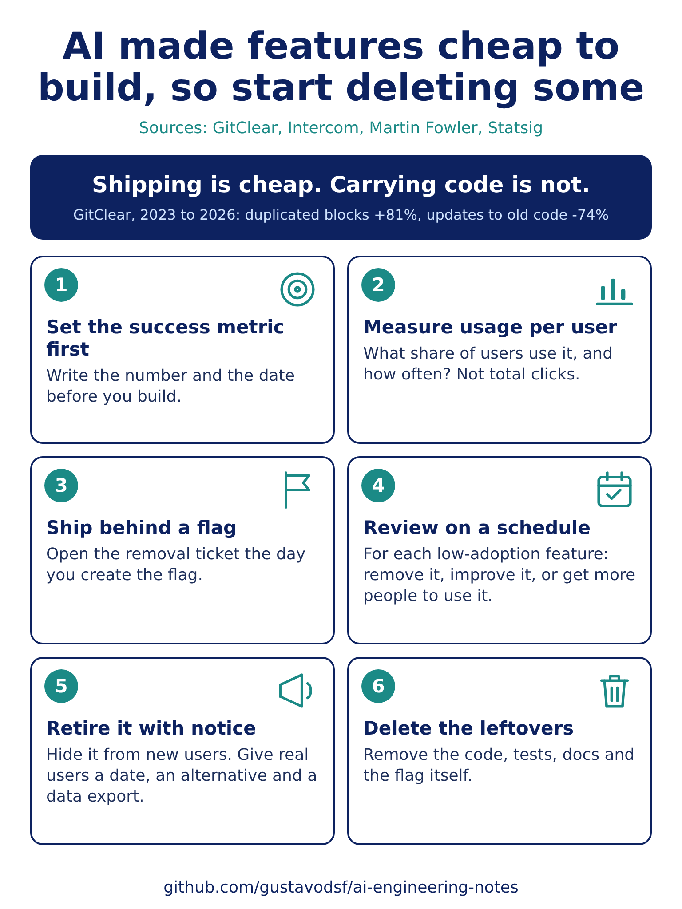

# AI made features cheap to build, so start deleting some

AI made features cheap to build, so start deleting some

Coding agents let us ship in a day what used to take a sprint. But a feature isn't done when it ships. It has to be tested, upgraded and debugged for as long as it exists, even if nobody uses it.

The data points the same way. Martin Fowler cites Microsoft research: only about a third of the features built improved the metric they were meant to improve. And GitClear, looking at 623 million code changes, found the share of changes that update or remove code older than 12 months fell 74% from 2023 to 2026, while duplicated code blocks rose 81%. We add a lot and clean up very little.

Imagine an agent builds a weekly digest email in one afternoon. It now lives in your jobs, templates and tests. Nobody checks if anyone opens it, so it stays forever.

How to avoid that:

1. Before building, write the success metric and a date. "20% of active users open the digest within 60 days."
2. Measure usage per user, not total clicks. What share of users use it, and how often?
3. Ship behind a flag, and open the removal ticket the same day you create the flag.
4. Review on a schedule. For each low-adoption feature: remove it, improve it, or get more people to use it.
5. To remove: stop offering it to new users, then tell the people who really use it the date, an alternative and how to export their data.
6. Then delete the code, tests, docs and flag. A flag left behind is debt.

I use Claude and Codex every day, and work with agents that open and review PRs. Building is the cheap part now. Owning features end to end on backend and ledger systems at Inoa and Dock, I treat observability as part of the feature, not an extra.

When did your team last delete a feature on purpose?

Sources:
https://www.gitclear.com/the_ai_code_quality_maintainability_gap
https://www.intercom.com/blog/how-to-sunset-a-feature
https://martinfowler.com/bliki/Yagni.html
https://www.statsig.com/blog/feature-flag-code-cleanup

More detail in:
https://github.com/gustavodsf/ai-engineering-notes
https://github.com/gustavodsf/ai-engineering-notes/tree/main/AI%20made%20features%20cheap%20to%20build%2C%20so%20start%20deleting%20some

#SoftwareEngineering #AIEngineering #ProductEngineering #SoftwareArchitecture

## Draft

- [Post draft.md](./Post%20draft.md)

## Articles

- [The Maintainability Gap: AI Code Quality in 2026 — GitClear](./GitClear%20—%20The%20Maintainability%20Gap,%20AI%20Code%20Quality%20in%202026.md)
- [How to sunset a feature — Des Traynor, Intercom](./How%20to%20sunset%20a%20feature%20—%20Des%20Traynor,%20Intercom.md)
- [Yagni — Martin Fowler](./Yagni%20—%20Martin%20Fowler.md)
- [What no one tells you about feature flags and messy code — Statsig](./What%20no%20one%20tells%20you%20about%20feature%20flags%20and%20messy%20code%20—%20Statsig.md)
