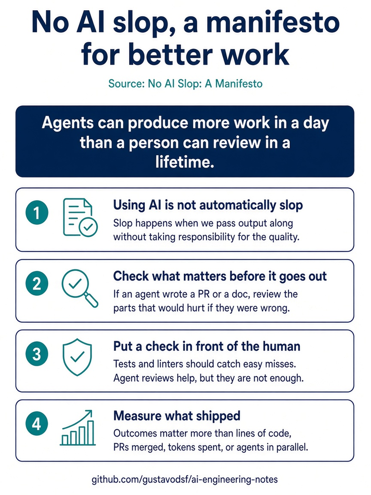

# No AI slop, a manifesto for better work

No AI slop, a manifesto for better work

Speakers and attendees of AIE Code Summit 2026 wrote "No AI Slop: A Manifesto." Slop is when we put less effort into producing something than we ask someone else to spend understanding it. Using AI does not automatically make work slop. It becomes slop when we pass it along without taking responsibility for the quality.

Agents can now produce more work in a day than a person can review in a lifetime. Faros found pull requests merged with no review are up 31.3% as AI adoption rises. Dex Horthy is blunt: agent reviews and linters help, but they are not enough.

1. Check the parts that matter before it goes out.
If an agent wrote a PR or a doc, say so, and review what would hurt if it were wrong. A schema change deserves more care than a prototype behind a flag.

2. Put a real check in front of the human.
Horthy calls this back pressure: tests and linters should catch the easy misses so a person is not the first filter. If a type checker can catch a mistake, let it catch it.

3. Measure what shipped, not how many agents you ran.
Lines of code, PRs merged, and tokens spent are easy to inflate. What matters is what shipped, who is using it, and how it is helping them.

I use Claude and Codex every day, and I build agents with tool use in production. The habit that holds up is a definition of done, a pass/fail check, and observability. I still own the taste and the consequences.

When was the last time you sent along an AI draft that you would not want to review yourself?

Sources:
https://www.slopmanifesto.com/
https://www.youtube.com/watch?v=-NFMsM2y0Vk
https://www.faros.ai/blog/ai-acceleration-whiplash-takeaways

More detail in:
https://github.com/gustavodsf/ai-engineering-notes
https://github.com/gustavodsf/ai-engineering-notes/tree/main/No%20AI%20slop%2C%20a%20manifesto%20for%20better%20work

#NoAISlop #AIEngineering #SoftwareQuality #Agents

## Draft

- [Post draft.md](./Post%20draft.md)

## Articles

- [No AI Slop: A Manifesto](./No%20AI%20Slop:%20A%20Manifesto.md)
- [12 Rules for a Software Factory That Doesn't Ship Slop — Dex Horthy, Factory](./12%20Rules%20for%20a%20Software%20Factory%20That%20Doesn't%20Ship%20Slop%20—%20Dex%20Horthy,%20Factory.md)
- [Ten takeaways from the AI Engineering Report 2026: The Acceleration Whiplash](./Ten%20takeaways%20from%20the%20AI%20Engineering%20Report%202026:%20The%20Acceleration%20Whiplash.md)
