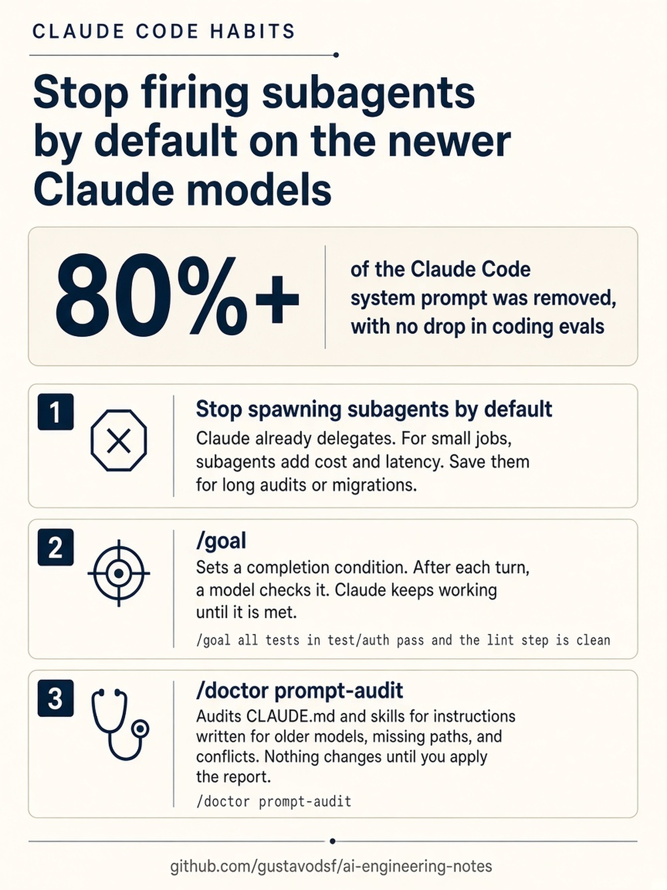

# Stop firing subagents by default on the newer Claude models

Stop firing subagents by default on the newer Claude models

Addy Osmani's point is simple: newer models need less prompting than most of us still give them. On Opus 5 and Fable 5, over 80% of the Claude Code system prompt was removed with no measurable drop in coding evals. The useful follow-through is to change how you run the session.

1. Don't spawn a subagent for every task
Claude already delegates on its own, so you rarely need to ask. For small jobs, subagents multiply cost and latency. They can parallelize work or give a second opinion, but they do not, by default, make the work smarter. Save them for substantial, standalone work such as a long audit or a migration.

2. Use /goal so Claude keeps going without you
/goal sets a completion condition. After each turn, a separate model checks whether that condition holds. If not, Claude starts another turn. Write a condition Claude's own output can prove:

/goal all tests in test/auth pass and the lint step is clean

Run /goal with no arguments to check status, and /goal clear to stop it.

3. Audit old instructions with /doctor prompt-audit
This checks CLAUDE.md, skills, and other instruction files for prompts written for older models, paths or commands that no longer exist, and rules that contradict each other. You get a report with proposed edits. Nothing changes until you ask Claude to apply them:

/doctor prompt-audit

I use Claude and Codex every day, and I build agents with tool use in production. The habit I trust is a clear definition of done, a check the agent can run, and less process the new model no longer needs.

What have you been sending to a subagent that the main session could finish on its own?

More detail in:
https://github.com/gustavodsf/ai-engineering-notes
https://github.com/gustavodsf/ai-engineering-notes/tree/main/Stop%20firing%20subagents%20by%20default%20on%20the%20newer%20Claude%20models

#ClaudeCode #AIEngineering #Agents #SoftwareEngineering

## Draft

- [Post draft.md](./Post%20draft.md)

## Articles

- [You're probably overprompting Claude](./You're%20probably%20overprompting%20Claude.md)
- [Anthropic Just Told Us How to Prompt Claude](./Anthropic%20Just%20Told%20Us%20How%20to%20Prompt%20Claude.md)
- [Getting the most out of Opus 5.5 in Claude and Claude Code](./Getting%20the%20most%20out%20of%20Opus%205.5%20in%20Claude%20and%20Claude%20Code.md)
- [Keep Claude working toward a goal](./Keep%20Claude%20working%20toward%20a%20goal.md)
- [How Claude remembers your project](./How%20Claude%20remembers%20your%20project.md)
