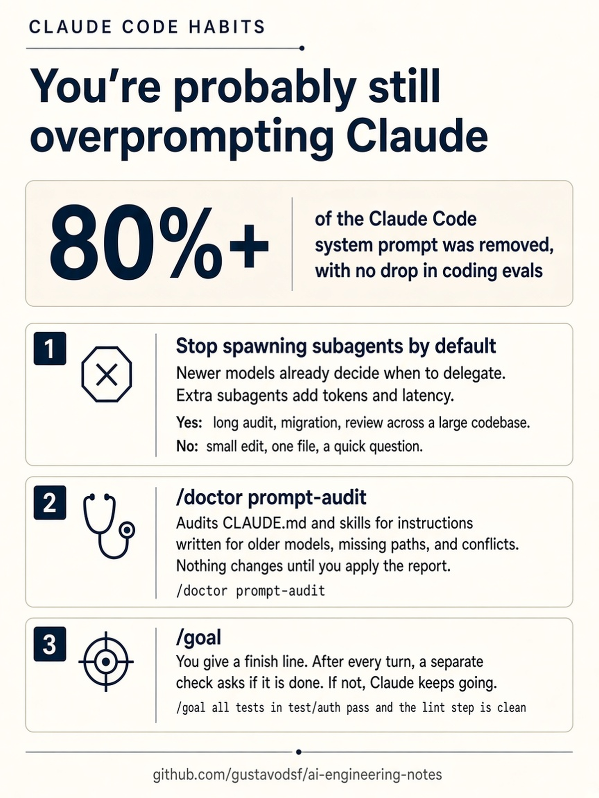

# You're probably still overprompting Claude

You're probably still overprompting Claude

Addy Osmani's article, "You're probably overprompting Claude," makes a simple case: newer models need less prompting than most of us still give them. On Opus 5 and Fable 5, over 80% of the Claude Code system prompt was removed with no measurable drop in coding evals. Here are three habits that follow from that.

1. Don't spawn a subagent for every task
Newer models already decide when to delegate, so you rarely need to ask. For small jobs, each extra subagent adds tokens and latency, and that cost is not worth it.

Yes: big, independent work, such as a long audit, a migration, or a review across a large codebase.
No: a small edit, a change in a single file, or a quick question.

2. Audit old instructions with /doctor prompt-audit
This checks CLAUDE.md, skills, and other instruction files for prompts written for older models, paths or commands that no longer exist, and rules that contradict each other. You get a report with proposed edits. Nothing changes until you ask Claude to apply them:

/doctor prompt-audit

3. Use /goal so Claude does not stop early
Without a goal, Claude often stops when it thinks it is done and waits for you. /goal solves that: you give a finish line, and after every turn a separate check asks whether it is done. If not, Claude keeps going.

/goal all tests in test/auth pass and the lint step is clean

Tip: write a finish line Claude can prove, such as tests passing.

I use Claude and Codex every day, and I build agents with tool use in production. The habit I trust is a clear definition of done, a check the agent can run, and less process the new model no longer needs.

What have you been sending to a subagent that the main session could finish on its own?

More detail in:
https://github.com/gustavodsf/ai-engineering-notes
https://github.com/gustavodsf/ai-engineering-notes/tree/main/You%27re%20probably%20still%20overprompting%20Claude

#ClaudeCode #AIEngineering #Agents #SoftwareEngineering

## Draft

- [Post draft.md](./Post%20draft.md)

## Articles

- [You're probably overprompting Claude](./You're%20probably%20overprompting%20Claude.md)
- [Anthropic Just Told Us How to Prompt Claude](./Anthropic%20Just%20Told%20Us%20How%20to%20Prompt%20Claude.md)
- [Getting the most out of Opus 5.5 in Claude and Claude Code](./Getting%20the%20most%20out%20of%20Opus%205.5%20in%20Claude%20and%20Claude%20Code.md)
- [Keep Claude working toward a goal](./Keep%20Claude%20working%20toward%20a%20goal.md)
- [How Claude remembers your project](./How%20Claude%20remembers%20your%20project.md)
