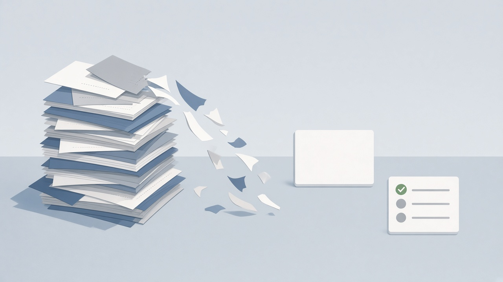

# You're probably still prompting Claude like last year's model

You're probably still prompting Claude like last year's model

Addy Osmani's latest piece makes a simple case: newer models need less prompting than most of us still give them. For Opus 5.5, one prompt with a clear goal and a way to verify the result is often enough. Then let the model work.

For teams shipping with AI, that change matters. Osmani notes that for Opus 5 and Fable 5, over 80% of the Claude Code system prompt was removed with no measurable drop in coding evals. His official Opus 5.5 guide says the same thing in practice: say what "done" looks like, drop "think carefully" lines, and let the model run. John Kim's walkthrough of the article adds the habit: audit skills and instructions written for older models, delete what the new one already handles, and keep a check the agent can run on its own.

I use Claude and Codex every day, and I build agents with tool use in production, including LangGraph, the Anthropic API, and MCP. The pattern that holds up is a clear definition of done, a pass/fail or numeric check, and observability so you can see what happened. Extra instructions are easy to accumulate. Evals tell you which ones still earn their place.

When a new model lands, do you prune your prompts and skills, or do you keep adding to them?

Source: https://x.com/addyosmani/article/2115688494865465370
Video: https://www.youtube.com/watch?v=3F75mndbrxg
Also: https://claude.dev/blog/getting-the-most-out-of-opus-5-5/
Notes and references: https://github.com/gustavodsf/ai-engineering-notes/tree/main/You%27re%20probably%20still%20prompting%20Claude%20like%20last%20year%27s%20model

#AIEngineering #ClaudeCode #Agents #Evals #SoftwareEngineering

## Draft

- [Post draft.md](./Post%20draft.md)

## Articles

- [You're probably overprompting Claude](./You're%20probably%20overprompting%20Claude.md)
- [Anthropic Just Told Us How to Prompt Claude](./Anthropic%20Just%20Told%20Us%20How%20to%20Prompt%20Claude.md)
- [Getting the most out of Opus 5.5 in Claude and Claude Code](./Getting%20the%20most%20out%20of%20Opus%205.5%20in%20Claude%20and%20Claude%20Code.md)
